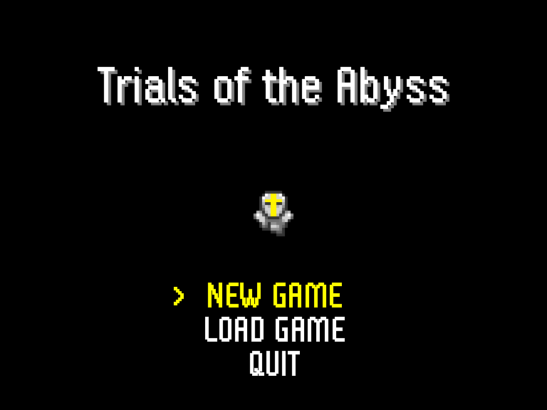
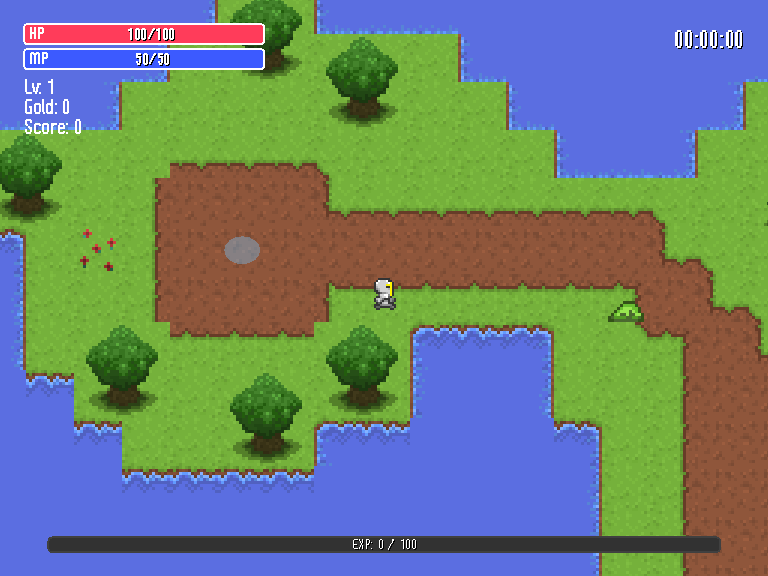
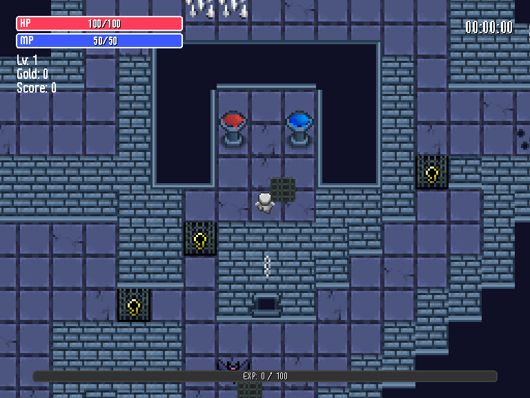
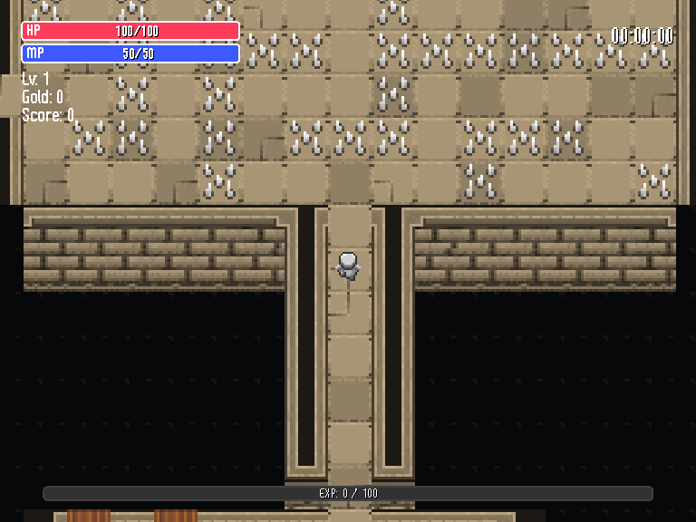
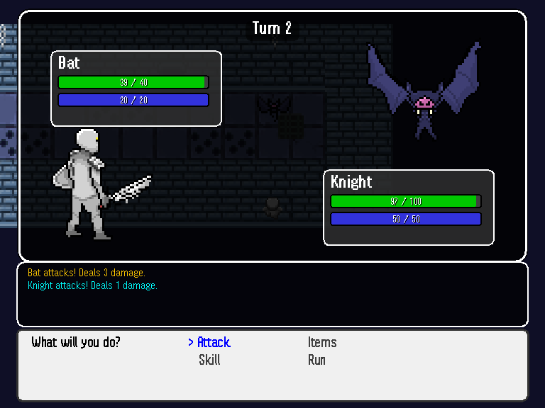
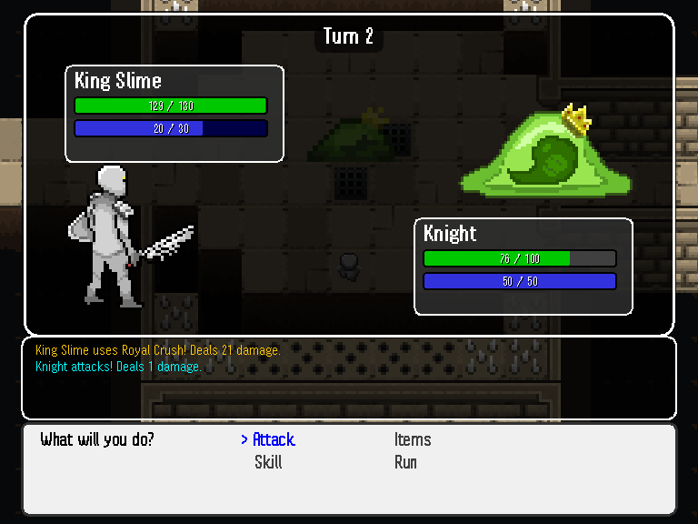
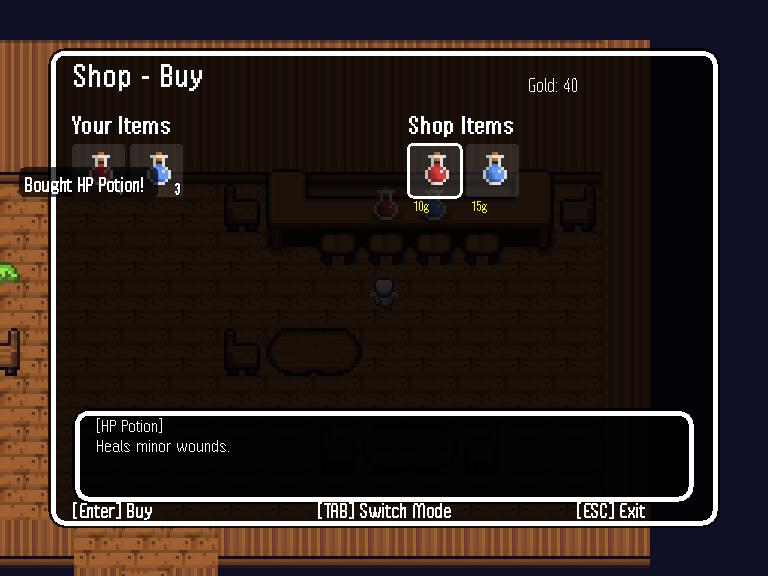

# Trials of the Abyss

A top-down pixel-art RPG written in Java (Swing). A knight crosses three worlds (forest islands, a stone dungeon and a sandstone temple), finds keys to open locked doors, survives spike traps, and fights turn-based battles against slimes, bats and the King Slime guarding the way out.

We made it as a team for our first-year Object-Oriented Programming course at Cebu Institute of Technology – University in March 2025. It was restored and finished in 2026 (see [2026 restoration](#2026-restoration) below).



| Forest islands | Stone dungeon | Sandstone temple |
|---|---|---|
|  |  |  |

| Battle | Boss | Potion shop |
|---|---|---|
|  |  |  |

## Play it

**In the browser:** `web/` holds a JavaScript port of the game with the same rules, numbers and screens. It runs from any static host (or open `web/index.html` through a local server), saves to the browser, and has on-screen controls on phones.

**As the Java original:** you need Java 17 or newer.

```sh
./build.sh                      # Windows: build.bat
java -jar dist/TrialsOfTheAbyss.jar
```

The game saves to `savegame1.txt` to `savegame3.txt` in the folder you run it from.

### Controls

| Key | Action |
|---|---|
| W A S D or arrow keys | Move, or move the menu cursor |
| Enter | Confirm. Walk into the potion shelf or face a fountain and press Enter to use it |
| I | Inventory |
| P | Pause menu (save game, quit to title) |
| Tab | Switch between buying and selling in the shop |
| Esc or Backspace | Back |

### How it plays

- **Three worlds.** Glowing pads teleport you around each world. The stairs at the end of a world take you to the next one.
- **Keys and doors.** Keys come from chests, from the ground, and from certain enemies. Each key opens one locked door, and leftover keys carry over to the next world.
- **Turn-based battles.** Walk into an enemy to fight it. You can Attack, use a Skill (Sword Strike, Iron Guard, Heavy Blow, Shield Bash), use an Item, or Run.
- **Getting stronger.** Battles give EXP, gold and score, and levelling up raises HP, MP, attack and defence. Red fountains restore HP and blue fountains restore MP. The tavern shelves sell potions.
- **Hazards.** Spike traps rise and fall, so time your crossing.
- **The boss.** The King Slime guards the exit of the third world. Beat it to escape the Abyss.

## Team

| Member | Role |
|---|---|
| **Vinci F. Villanueva** | All pixel art (characters, enemies, battle animations, tileset), the three world maps, and the level design: placement of teleporters, keys, doors, traps, fountains and the boss |
| **Miguel Matheo C. Rivero** | Pixel-to-code integration |
| **Christian Kyle B. Tapales** | Game mechanics and gameplay |
| **Marc Louis P. Ortizano** | Programming |
| **Matt Cedric N. Ybanez** | Programming |
| **Wyben C. Daal** | Programming |

## Testing

```sh
./tests/run_playthrough.sh            # Java: headless playthrough + save/load, shop, fountain and boss-gate checks
python -m http.server 8866 -d web &   # then, with Playwright for Python installed:
python tests/web_playthrough.py       # browser version: plays to the ending with outside network blocked
```

The playthrough bots start a new game and play it to the end through the real game code: they walk with the actual movement and collision, collect keys, open chests and doors, use teleporters and fountains, fight the battles, beat the King Slime and confirm the ending screen. The Java bot also saves screenshots of each milestone to `tests/out/shots`.

## Project layout

```
src/
  main/      GamePanel (game loop, worlds, save/load), KeyHandler, UI, BattleHandler,
             EventHandler (teleporters, spikes, fountains), CollisionChecker, AssetSetter, WorldData
  entity/    Entity, Player, Combatant interface, NPC_ShopKeeper (the potion shelf)
  monster/   Monster base class, MON_Slime, MON_Bat, MON_KingSlime
  object/    OBJ_Key, OBJ_Chest, OBJ_Door and the inventory items (potions, key)
  battle/    BattleScreenDrawer
  tile/      TileManager (map loading and drawing, animated spikes)
res/         art, maps, sound and font loaded at runtime
design/      Vinci's original level design: placement notes and the three world grids
web/         browser version (index.html, game.js, data.js, assets/)
tools/       gen_worlddata.py (WorldData.java, maps and web/data.js from design/), build_web.py, chiptune.py (music)
tests/       automated playthroughs for the Java and browser versions
docs/        screenshots
```

## 2026 restoration

The code we had was a March 2025 snapshot that we'd passed around as a zip; it never went into a repository. It ran, but it used placeholder characters and only loaded an early version of the first world. The restoration finished what the design files describe:

- **Vinci's art is in the game.** That covers the overworld knight (4 directions × 4 frames), the animated battle sprites for the knight (idle, sword attack and shield block), slime, bat and King Slime, the overworld enemies, the animated spikes, and key, chest, door and potion sprites taken from his own tileset.
- **All three worlds are playable.** They're built from Vinci's map grids and placement notes: teleporters, locked doors and keys, chests, key-dropping enemies, fountains, spike traps, a power-up, the shop shelves, world-to-world stairs and the King Slime boss, with an ending screen.
- **Fixes to the 2025 code:**
  - Battle messages never appeared because `drawMessage` was an empty stub.
  - Iron Guard didn't do anything; it now halves the next hit.
  - Running from a battle started a new one straight away.
  - The battle status boxes covered the sprites.
- **Level design adjustments:**
  - The two doors in world 1 sat one tile off the path, so they were moved onto it.
  - A few extra wandering enemies were added so the player can level up before the boss.
  - The game tops up keys on entering a world, so a run can never get stuck behind a locked door.
- **Placeholders removed.** The placeholder characters, items and music weren't the team's own, so they have all been removed. The music and sound effects are now original chiptune made with `tools/chiptune.py`.

- **A browser version (`web/`).** A JavaScript port of the game, so it can be played on a portfolio page.

An automated playthrough of both versions checks the whole route (see [Testing](#testing)).

## Credits

- The engine's structure (GamePanel, KeyHandler, TileManager, CollisionChecker, AssetSetter) follows RyiSnow's YouTube series *How to Make a 2D Game in Java*.
- The font is [x12y16pxMaruMonica](https://www.maoken.com/freefonts/15534.html) by hicc, a free font that allows commercial use.
- The music and sound effects are original, generated with `tools/chiptune.py`.
